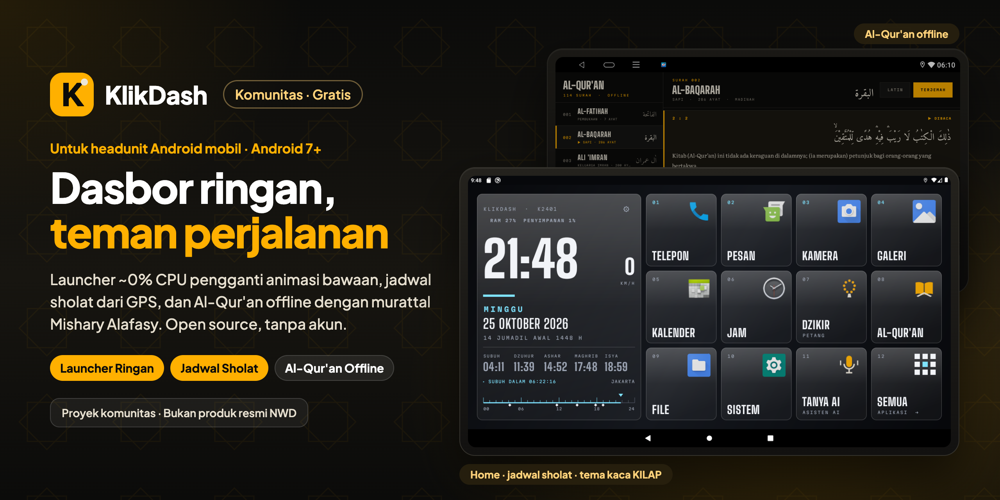

  

  Launcher ringan, gratis, dan open source untuk headunit Android mobil (Android 7 atau lebih baru): home bergaya panel instrumen pengganti animasi 3D bawaan, jadwal sholat dari GPS dengan hitung mundur, suhu CPU, pintasan yang bisa disusun, Al-Qur'an offline dengan murattal Mishary Alafasy, dan asisten suara opsional untuk perintah mobil. Tanpa akun. Dikembangkan dan diuji di NWD K2401.

  ⚠️ <b>Tidak resmi.</b> KlikDash adalah launcher buatan komunitas. Tidak dibuat, didukung, maupun disahkan oleh NWD atau produsen headunit.

  
  
  
  
  
   
  
  
  

  

  Bagian dari <a href="https://klikapps.pages.dev"><b>Klik Apps</b></a>, kumpulan aplikasi gratis dan open source: <a href="https://klikapps.pages.dev">klikapps.pages.dev</a>

  <a href="README.md">English</a> | <b>Bahasa Indonesia</b> 
  Proyek komunitas, tidak berafiliasi dengan NWD.

## Tentang

KlikDash menggantikan launcher bawaan headunit dengan home statis bergaya panel instrumen (~0–1% CPU, ~30 MB RAM).
Ditulis dengan Java murni tanpa library. Tampilan berbahasa Indonesia atau Inggris (**⚙ › Launcher › BAHASA**),
dan asisten suara punya pengaturan bahasanya sendiri. Di NWD K2401 tempat KlikDash dikembangkan, launcher bawaannya terus
merender animasi 3D (~40% CPU).

## Fitur

- **Home:** jam besar, kecepatan dari GPS, tanggal Masehi dan Hijriah, suhu CPU, serta hingga 11 pintasan yang bisa
  disusun ulang dengan tekan lama (tampilkan 12, 9, 6, atau 4 pintasan: makin sedikit, makin besar jam dan pintasannya, makin mudah dibaca).
- **Jadwal sholat:** offline, metode Kemenag, lokasi dari GPS, hitung mundur ke waktu sholat berikutnya.
- **Al-Qur'an:** 114 surah dengan teks dan terjemahan Kemenag, murattal Mishary Rashid Alafasy per ayat, bisa
  dibaca offline.
- **Dzikir:** dzikir pagi dan petang dengan penghitung terpandu, dan audio yang tetap diputar di latar sambil
  menyetir (tiap bacaan diulang sebanyak hitungannya dan penghitung ikut bertambah).
- **Notch pemutar:** selama murattal, dzikir, atau musik aplikasi lain (Spotify, YouTube Music, ...) diputar, bilah
  kecil di atas home menampilkan yang diputar, dengan tombol jeda dan berikutnya.
- **Hemat Daya:** larang aplikasi seperti Netflix atau Spotify berjalan di latar.
- **Asisten suara TANYA AI (opsional):** ucapkan *"putar surat Yasin"*, *"navigasi ke masjid terdekat pakai Waze"*,
  atau *"buka Zlink"*. Pakai key Claude atau OpenAI-compatible sendiri; mendengar dan berbicara dengan suara
  Android headunit (gratis) atau ElevenLabs, dan mencari info terkini di web (pencarian Claude, atau pencarian
  TinyFish yang gratis untuk penyedia mana pun). ▶️ **[Video cara mengaturnya](https://youtu.be/v9Bm6FzUKm8)** (6 menit, dengan subtitle).
- **Kunci layar:** PIN 4 angka (**⚙ › Launcher › KUNCI LAYAR**) dan ikon gembok di home, supaya anak-anak tidak
  membuka aplikasi atau mengubah pengaturan. Jam dan jadwal sholat tetap tampil.
- **Pengaturan & pembaruan:** tombol ⚙ di home; empat tema (AMBER, ZAMRUD, SIANG, dan KILAP berpanel kaca);
  **CEK UPDATE** memasang versi baru tanpa komputer, dan **CEK UPDATE OTOMATIS** (opsional, bawaan mati)
  menawarkannya sendiri saat headunit menyala.

## Pemasangan

▶️ **[Video tutorial di YouTube](https://youtu.be/sSRKIyC3Ato)** (5 menit, dengan subtitle) ·
👉 **[Panduan langkah demi langkah](docs/INSTALL.id.md)** dengan screenshot dan tanya jawab ·
📺 **[Semua video tutorial](https://www.youtube.com/playlist?list=PLEAZ252hW8a4)**: pemasangan, TANYA AI, pencarian web TinyFish, update

1. Unduh `klikdash-<versi>.apk` dari [Releases](https://github.com/ashafizullah/klikdash/releases/latest), lalu
   salin ke flashdisk.
2. Di headunit, buka APK-nya lewat file manager, ketuk **INSTALL**, lalu **OPEN**.
3. Ketuk tombol kuning **JADIKAN TAMPILAN UTAMA** (di firmware NWD butuh USB debugging aktif).
4. Saat ada internet, buka **Al-Qur'an** sekali dan ketuk **UNDUH TEKS**.
5. Jalankan [daftar uji sebelum berkendara](#disclaimer) dalam keadaan mobil diam.

Memperbarui: **⚙ › Launcher › CEK UPDATE** (mulai 1.3.0), atau pasang APK baru di atas yang lama. Pengaturan dan
audio tetap ada.

## Perangkat yang didukung

KlikDash butuh **Android 7.0 atau lebih baru** dan dirancang untuk layar **1280×720 landscape**.
Bagian yang khusus headunit (launcher default, tidur/bangun, Zlink, ksmd) ditujukan untuk firmware NWD. Bagian ini
berjalan lewat ADB headunit itu sendiri, jadi USB debugging harus aktif; headunit yang bertanya "Allow USB
debugging?" didukung, dan di Android 11 ke atas ADB biasanya perlu dibuka sekali dari komputer (`adb tcpip 5555`,
lihat [docs/INSTALL.id.md](docs/INSTALL.id.md)).

| Perangkat | Layar | Android | Status |
|---|---|---|---|
| NWD K2401 (Allwinner sun50iw10) | 1280×720 | 10 | ✅ diuji di perangkat asli |
| Headunit lain dengan firmware NWD | 1280×720 | 7+ | ⚠️ seharusnya jalan, belum diuji |
| Headunit Android lain (FYT, MTK, Rockchip, …) | 1280×720 | 7+ | ⚠️ launcher, jadwal sholat, dan Al-Qur'an seharusnya jalan; penyetelan khusus NWD tidak berlaku |
| Ukuran layar lain atau layar portrait | 800×480 ke atas | 7+ | ⚠️ tata letak menyesuaikan (dicek di emulator berbagai ukuran), belum diuji di perangkat asli |

Di Android 7.0–8.1 (dicek di emulator, belum di headunit asli) semua fitur jalan, hanya Hemat Daya yang lebih
lemah: Android 8.1 ke bawah belum punya pembatasan latar yang ketat, jadi aplikasi yang diblokir hanya dihentikan
paksa dan dilarang berjalan di latar.

Zlink dipakai dengan CarPlay nirkabel di iPhone; Android Auto belum diuji. Laporan dari headunit lain sangat membantu:
buka issue dengan menyebut model, ukuran layar, dan versi Android.

## Perubahan pada headunit

Semua yang diubah KlikDash, dan cara mengembalikannya. **KlikDash tidak menghapus atau mematikan aplikasi apa
pun**; ia mengganti tampilan home, dan fitur Hemat Daya (opsional) hanya melarang aplikasi pilihan Anda berjalan
di latar.

| Perubahan | Kapan | Cara mengembalikan |
|---|---|---|
| Launcher default `persist.nwd.launcher.default=com.ashafizullah.klikdash` (NWD) dan preferensi HOME | Saat Anda mengetuk **JADIKAN TAMPILAN UTAMA** | **Pengaturan › Launcher › LAUNCHER BAWAAN**, atau `adb shell setprop persist.nwd.launcher.default com.android.launcher` |
| ksmd dimatikan | Setiap boot, selama KlikDash jadi tampilan home (butuh ADB aktif) | Kembali ke launcher bawaan atau uninstall KlikDash, lalu reboot |
| Zlink dikembalikan ke home bila terbuka sendiri | 3 menit pertama setelah boot atau bangun dari tidur | Sama seperti di atas |
| Aplikasi dilarang jalan di latar (`appops RUN_ANY_IN_BACKGROUND/RUN_IN_BACKGROUND ignore`) | Hanya untuk aplikasi yang Anda nyalakan di **HEMAT DAYA**, atau atas permintaan ke TANYA AI | Ketuk aplikasinya lagi, atau **KEMBALIKAN SEMUA** |
| Kunci ADB KlikDash diizinkan (headunit yang bertanya "Allow USB debugging?") | Sekali, saat Anda mencentang **Always allow** pertama kali KlikDash butuh ADB | **Pengaturan › Opsi pengembang › Cabut otorisasi debug USB** (komputer yang pernah diizinkan juga ikut dicabut) |
| KlikDash diperbarui dengan `pm install` | Hanya saat Anda mengetuk **Unduh & pasang** di Pengaturan | Pasang APK lama dengan `adb install -r -d` |

Launcher NWD lama **tidak dihapus**. Prosesnya tetap ada karena juga menangani info mobil dari CAN.

## Catatan

- **Privasi dan biaya asisten suara.** Ucapan Anda ditranskripsi oleh pengenal yang dipilih di **Pengenalan
  suara**: Android (aplikasi Google, diproses Google) atau ElevenLabs Scribe. Teksnya, beserta
  daftar nama aplikasi terpasang, jam sekarang, dan lokasi bila perintahnya butuh, dikirim ke penyedia AI profil
  yang aktif. Pemakaian ditagihkan ke akun Anda sendiri. Tidak ada yang lewat server KlikDash. AI bisa keliru:
  periksa apa yang dilakukannya, dan jangan andalkan untuk hal yang menyangkut keselamatan.
- **Suara dan pengenal suara Android (opsional).** **Suara jawaban** dan **Pengenalan suara** masing-masing bisa
  ANDROID atau ELEVENLABS. ANDROID memakai mesin headunit sendiri lewat API standar Android, jadi tidak butuh akun
  ElevenLabs. Bila headunit belum punya, ketuk ANDROID untuk membuka aplikasinya di Play Store:
  [Speech Recognition & Synthesis](https://play.google.com/store/apps/details?id=com.google.android.tts) (Speech Services by Google) untuk berbicara dan
  [aplikasi Google](https://play.google.com/store/apps/details?id=com.google.android.googlequicksearchbox) untuk mendengar.
  Keduanya aplikasi terpisah dan gratis dari Google dengan ketentuan Google sendiri; KlikDash tidak menyertakan
  atau menyebarkannya ulang. Setelah suara bahasa Indonesia diunduh di Speech Recognition & Synthesis, jawaban
  dibacakan offline; ucapan yang dikenali aplikasi Google diproses Google. Firmware yang memblokir pembaruan Google
  Play services (seperti NWD) bisa membuat aplikasi Google meminta pembaruan; pengenal suaranya tetap berfungsi.
- **Keamanan.** ADB WiFi yang aktif memberi akses penuh ke headunit. Hanya sambungkan headunit ke jaringan
  pribadi (misalnya hotspot HP sendiri), jangan ke WiFi publik.
- **Akurasi jadwal sholat** ±1 menit dibanding jadwal Kemenag (sudah dibandingkan untuk Jakarta,
  26 Oktober 2026).

## Disclaimer

**Gunakan dengan risiko sendiri.** Perangkat lunak ini diberikan "apa adanya", tanpa jaminan apa pun
(lihat [LICENSE](LICENSE)).

> ⚠️ **Uji dulu sebelum berkendara.** Setelah memasang KlikDash, dalam keadaan mobil diam, pastikan semua ini masih berfungsi:
> - **Kamera mundur:** masuk gigi R, gambar kamera harus langsung muncul.
> - **Kamera 360** (jika ada).
> - **Peringatan pintu terbuka dan info mobil** dari CAN.
> - **Tombol setir:** volume, lagu berikutnya, dan telepon.
> - **Radio, Bluetooth, dan telepon.**
>
> Kalau ada yang tidak jalan, **kembalikan ke launcher bawaan** (lihat
> [Perubahan pada headunit](#perubahan-pada-headunit)) dan laporkan lewat issue. Jangan berkendara dengan kamera
> mundur yang tidak berfungsi. Sebagian firmware menampilkan kamera mundur atau peringatan pintu lewat launcher
> bawaan, jadi hasilnya bisa berbeda di tiap headunit.

- Mengganti launcher default dan pengaturan sistem tidak didukung produsen headunit dan bisa berpengaruh
  pada garansi. Semua perubahan bisa dikembalikan (lihat [Perubahan pada headunit](#perubahan-pada-headunit)).
- **Jangan mengoperasikan layar sambil menyetir.** Pakai tombol setir, atau berhenti dengan aman dulu. TANYA AI
  tetap perlu diketuk untuk mulai mendengar; cukup perintah singkat dan tetap fokus ke jalan.
- Jadwal sholat adalah hasil hitungan dan bisa selisih sekitar satu menit dari jadwal resmi; ikuti masjid
  atau otoritas setempat.
- Teks Al-Qur'an dan terjemahannya tidak disertakan; periksa teks yang Anda bangun terhadap mushaf resmi.
- KlikDash adalah proyek komunitas dan tidak berafiliasi dengan maupun didukung oleh NWD.

## Untuk developer

Struktur kode, build tanpa Gradle, audio murattal, membuat teks Al-Qur'an, dan cara kerja firmware NWD: lihat
**[docs/DEVELOPMENT.id.md](docs/DEVELOPMENT.id.md)**.

## Dukungan

KlikDash gratis. Kalau bermanfaat, **[traktir saya token AI di Trakteer](https://trakteer.id/adamshafizullah/tip)** ☕🤖.

## Sumber & lisensi

- **Kode:** [MIT](LICENSE).
- **Font:** [SIL Open Font License 1.1](assets/licenses/), yaitu Big Shoulders, Martian Mono, Amiri Quran,
  dan Literata (via Google Fonts). Literata di-instance dan di-subset; nama dan lisensinya tetap.
- **Teks, transliterasi, dan terjemahan** (tidak disertakan): [equran.id](https://equran.id), yaitu mushaf
  standar dan terjemahan Kemenag RI. Hak dan ketentuannya ada pada pemiliknya.
- **Terjemahan Inggris** (tidak disertakan, diunduh bila diminta): Saheeh International lewat
  [alquran.cloud](https://alquran.cloud) (dari [Tanzil](https://tanzil.net/trans/)). Haknya ada pada pemiliknya.
- **Audio** (tidak disertakan): [everyayah.com](https://everyayah.com) / versebyversequran.com, Mishary
  Rashid Alafasy 128 kbps. Ikuti lisensi di situs tersebut.
- **Jadwal sholat:** dihitung di perangkat dengan parameter Kemenag RI (Subuh 20°, Isya 18°, Ashar Syafi'i,
  ihtiyath +2 menit), memakai rumus posisi matahari perkiraan dari U.S. Naval Observatory dan hari Julian dari
  *Astronomical Algorithms* karya Meeus.
- **Dzikir** (`assets/dzikir.json`): dari [KlikBand](https://github.com/ashafizullah/klikband); urutan dan jumlah dari
  [Almanhaj](https://almanhaj.or.id/11518-dzikir-pagi-dan-petang.html), Latin mengikuti Hisnul Muslim, ayat
  Al-Qur'an dari [Tanzil](https://tanzil.net): Tanzil Quran Text (Simple Plain, Version 1.1), © Tanzil Project,
  CC BY 3.0 dengan ketentuan Tanzil (hanya salinan apa adanya, dengan kredit dan tautan). Bangun ulang dengan
  `node tools/build_dzikir.mjs <klikband>/src/common/dhikrmorningevening.js assets/dzikir.json`.
  Audio dzikir: ayat Al-Qur'an dibacakan Mishary Rashid Alafasy (everyayah.com); bacaan lainnya rekaman KlikDash di
  `audio/dzikir/`, diunduh aplikasi sekali (`python3 tools/build_dzikir_audio.py <folder rekaman>`).

Proyek ini tidak berafiliasi dengan NWD, Zjinnova (Zlink), Apple, Google, Anthropic, OpenAI, ElevenLabs, TinyFish,
maupun Kemenag RI. Nama produk adalah merek dagang pemiliknya.

  
  &nbsp;Dibuat oleh <a href="https://github.com/ashafizullah"><b>Adam Suchi Hafizullah</b></a>

