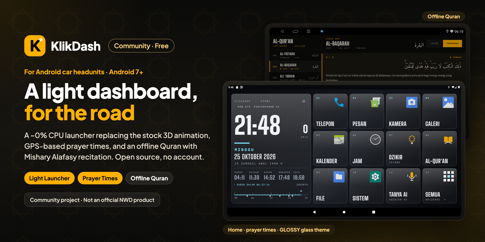

  

  A free, open-source lightweight launcher for Android car headunits (Android 7 or newer): an instrument-panel home screen that replaces the stock 3D animation, GPS-based prayer times with a live countdown, CPU temperature, rearrangeable shortcuts, an offline Quran with Mishary Alafasy recitation, and an optional voice assistant for car commands. No account needed. Developed and tested on an NWD K2401.

  ⚠️ <b>Unofficial.</b> KlikDash is a community-made launcher. It is not made, endorsed or supported by NWD or any headunit manufacturer.

  
  
  
  
  
   
  
  
  

  

  Part of <a href="https://klikapps.pages.dev"><b>Klik Apps</b></a>, a collection of free and open-source apps: <a href="https://klikapps.pages.dev">klikapps.pages.dev</a>

  <b>English</b> | <a href="README.id.md">Bahasa Indonesia</a> 
  Community project, not affiliated with NWD.

## About

KlikDash replaces the headunit's stock launcher with a static instrument-panel home screen (~0–1% CPU,
~30 MB RAM). Plain Java, no libraries. The interface is in Indonesian or English (**⚙ › Launcher › BAHASA / LANGUAGE**), and the
voice assistant has its own language setting. On the NWD K2401 it was built on, the
stock launcher renders a 3D animation nonstop (~40% CPU).

## Features

- **Home:** large clock, speed from GPS, Gregorian and Hijri date, CPU temperature, and up to 11 shortcuts you can
  rearrange by long-pressing (show 12, 9, 6 or 4 shortcuts: with fewer shortcuts the clock and the shortcuts are bigger and easier to read).
- **Prayer times:** offline, Kemenag method, location from GPS, live countdown to the next prayer.
- **Al-Qur'an:** all 114 surahs with Kemenag text and translation, verse-by-verse recitation by Mishary Rashid
  Alafasy, readable offline.
- **Dhikr:** morning and evening readings with a guided counter.
- **Power saver:** stop apps such as Netflix or Spotify from running in the background.
- **Voice assistant TANYA AI (optional):** say *"putar surat Yasin"*, *"navigasi ke masjid terdekat pakai Waze"* or
  *"buka Zlink"*. Bring your own Claude or OpenAI-compatible key; it listens and speaks with the headunit's
  free Android voice or with ElevenLabs, and looks up current information on the web (Claude's web search, or free
  TinyFish search for any provider). ▶️ **[Setup video](https://youtu.be/v9Bm6FzUKm8)** (6 minutes, Indonesian with subtitles).
- **Screen lock:** a 4-digit PIN (**⚙ › Launcher › SCREEN LOCK**) and a padlock on the home screen, so children
  cannot open apps or change settings. The clock and prayer times stay visible.
- **Settings & updates:** the ⚙ button on the home screen; **CEK UPDATE** installs new versions without a computer.

## Install

▶️ **[Video tutorial on YouTube](https://youtu.be/sSRKIyC3Ato)** (5 minutes, Indonesian with subtitles) ·
👉 **[Step-by-step guide](docs/INSTALL.md)** with screenshots and FAQ ·
📺 **[All video tutorials](https://www.youtube.com/playlist?list=PLEAZ252hW8a4)**: install, TANYA AI, TinyFish web search, updates

1. Download `klikdash-<version>.apk` from [Releases](https://github.com/ashafizullah/klikdash/releases/latest) and
   copy it to a USB stick.
2. On the headunit, open the APK in the file manager and tap **INSTALL**, then **OPEN**.
3. Tap the yellow **JADIKAN TAMPILAN UTAMA** button (on NWD firmware this needs USB debugging on).
4. With internet on, open **Al-Qur'an** once and tap **UNDUH TEKS**.
5. Go through the [test-before-you-drive checklist](#disclaimer) with the car parked.

Updating: **⚙ › Launcher › CEK UPDATE** (from 1.3.0), or install the new APK over the old one. Settings and audio
are kept.

## Supported devices

KlikDash needs **Android 7.0 or newer** and is designed for a **1280×720 landscape** screen. The
headunit-specific parts (default launcher, sleep/wake, Zlink, ksmd) target NWD firmware.

| Device | Screen | Android | Status |
|---|---|---|---|
| NWD K2401 (Allwinner sun50iw10) | 1280×720 | 10 | ✅ tested on a real device |
| Other headunits with NWD firmware | 1280×720 | 7+ | ⚠️ should work, not tested |
| Other Android headunits (FYT, MTK, Rockchip, …) | 1280×720 | 7+ | ⚠️ launcher, prayer times and Quran should work; NWD-specific tweaks do not apply |
| Other screen sizes or portrait screens | 800×480 and up | 7+ | ⚠️ the layout adapts (checked on an emulator at several sizes), not tested on a real device |

On Android 7.0–8.1 (checked on an emulator, not yet on a real headunit) everything works, except that the
Power Saver is weaker: Android 8.1 and older lack the stricter background restriction, so blocked apps are only
force-stopped and denied background running.

Zlink was used with wireless CarPlay on an iPhone; Android Auto has not been tested. Reports from other headunits are
welcome: please open an issue with the model, screen size and Android version.

## Changes made on the headunit

Everything KlikDash changes, and how to undo it. **KlikDash does not uninstall or disable any apps**; it
replaces the home screen, and the optional power saver only stops apps you pick from running in the background.

| Change | When | How to undo it |
|---|---|---|
| Default launcher `persist.nwd.launcher.default=com.ashafizullah.klikdash` (NWD) and HOME preference | When you tap **JADIKAN TAMPILAN UTAMA** | **Settings › Launcher › LAUNCHER BAWAAN**, or `adb shell setprop persist.nwd.launcher.default com.android.launcher` |
| ksmd turned off | Every boot, while KlikDash is the home screen (needs ADB on) | Switch back to the stock launcher or uninstall KlikDash, then reboot |
| Zlink sent back to home when it opens by itself | First 3 minutes after boot or wake-up | Same as above |
| Apps blocked from running in the background (`appops RUN_ANY_IN_BACKGROUND/RUN_IN_BACKGROUND ignore`) | Only for apps you switch on in **HEMAT DAYA**, or ask TANYA AI to | Tap the app again, or **KEMBALIKAN SEMUA** |
| KlikDash updated with `pm install` | Only when you tap **Unduh & pasang** in Settings | Install an older APK with `adb install -r -d` |

The old NWD launcher is **not removed**. Its process stays because it also handles car info from the CAN bus.

## Notes

- **Voice assistant privacy and cost.** What you say is transcribed by the recognizer chosen under
  **Pengenalan suara**: Android (the Google app, processed by Google) or ElevenLabs Scribe. The text, with
  the list of installed app names, the current time and, when a command needs it, the location, goes to the AI
  provider of the active profile. Usage is billed to your own accounts. Nothing goes through a KlikDash server.
  The AI can be wrong: check what it did, and do not rely on it for anything safety-critical.
- **Android voice and speech recognition (optional).** **Suara jawaban** and **Pengenalan suara** each choose
  ANDROID or ELEVENLABS. ANDROID uses the headunit's own engines through the standard Android API, so no
  ElevenLabs account is needed. If the headunit has none, tapping ANDROID opens the app in the Play Store:
  [Speech Recognition & Synthesis](https://play.google.com/store/apps/details?id=com.google.android.tts) (Speech Services by Google) to speak and the
  [Google app](https://play.google.com/store/apps/details?id=com.google.android.googlequicksearchbox) to listen. Both are
  separate, free apps from Google under Google's own terms; KlikDash does not include or redistribute them. With
  the Indonesian voice downloaded in Speech Recognition & Synthesis, answers are spoken offline; what the Google
  app recognizes is processed by Google. Firmware that blocks Google Play services updates (such as NWD) may make
  the Google app ask for one; recognition still works.
- **Security.** Enabled ADB over WiFi gives full access to the headunit. Only connect the headunit to a
  private network (such as your own phone's hotspot), never to public WiFi.
- **Prayer-time accuracy** is within ±1 minute of the Kemenag schedule (compared for Jakarta,
  26 October 2026).

## Disclaimer

**Use at your own risk.** This software is provided "as is", without warranty of any kind (see [LICENSE](LICENSE)).

> ⚠️ **Test before you drive.** After installing KlikDash, with the car parked, check that all of these still work:
> - **Reverse camera:** shift into R and the camera image must appear right away.
> - **360° camera** (if fitted).
> - **Door-open warnings and car info** from the CAN bus.
> - **Steering-wheel buttons:** volume, next track and phone.
> - **Radio, Bluetooth and phone calls.**
>
> If anything does not work, **switch back to the stock launcher** (see
> [Changes made on the headunit](#changes-made-on-the-headunit)) and report it in an issue. Do not drive with a
> reverse camera that is not working. Some firmware shows the reverse camera or door warnings through the stock
> launcher, so this can differ from headunit to headunit.

- Changing the default launcher and system settings is not supported by the headunit maker and may affect
  your warranty. Every change can be undone (see [Changes made on the headunit](#changes-made-on-the-headunit)).
- **Do not operate the screen while driving.** Use the steering-wheel buttons, or stop safely first. TANYA AI
  still needs a tap to start listening; keep it to short commands and keep your eyes on the road.
- Prayer times are calculated and may differ by a minute or so from official schedules; follow your local
  mosque or authority.
- The Quran text and translation are not included; check the text you build against an official mushaf.
- KlikDash is a community project and is not affiliated with or endorsed by NWD.

## For developers

Code structure, building without Gradle, the recitation audio, building the Quran text, and how the NWD firmware
behaves: see **[docs/DEVELOPMENT.md](docs/DEVELOPMENT.md)**.

## Sources & licenses

- **Code:** [MIT](LICENSE), except `PrayerTimes.java` (see prayer times below).
- **Fonts:** [SIL Open Font License 1.1](assets/licenses/): Big Shoulders, Martian Mono, Amiri Quran, and
  Literata (via Google Fonts). Literata is instanced and subset; its name and license are unchanged.
- **Text, transliteration, and translation** (not included): [equran.id](https://equran.id), i.e. the
  Kemenag RI standard mushaf and translation. Rights and terms belong to their owners.
- **English translation** (not included, downloaded on request): Saheeh International via
  [alquran.cloud](https://alquran.cloud) (from [Tanzil](https://tanzil.net/trans/)). Rights belong to its owners.
- **Audio** (not included): [everyayah.com](https://everyayah.com) / versebyversequran.com, Mishary Rashid
  Alafasy 128 kbps. Follow the license on that site.
- **Prayer times:** `PrayerTimes.java` is a Java port of [PrayTimes.js](https://praytimes.org) (© PrayTimes.org,
  Hamid Zarrabi-Zadeh, GNU LGPL v3.0, used with credit and a link as its terms of use ask).
- **Dhikr** (`assets/dzikir.json`): from [KlikBand](https://github.com/ashafizullah/klikband); order and counts from
  [Almanhaj](https://almanhaj.or.id/11518-dzikir-pagi-dan-petang.html), Latin following Hisnul Muslim, Qur'an
  verses from [Tanzil](https://tanzil.net) (© Tanzil Project, CC BY 3.0 with Tanzil's terms: verbatim copies only,
  with credit and a link). Rebuild with
  `node tools/build_dzikir.mjs <klikband>/src/common/dhikrmorningevening.js assets/dzikir.json`.

This project is not affiliated with NWD, Zjinnova (Zlink), Apple, Google, Anthropic, OpenAI, ElevenLabs, TinyFish,
or Kemenag RI. Product names are trademarks of their owners.

  
  &nbsp;Built by <a href="https://github.com/ashafizullah"><b>Adam Suchi Hafizullah</b></a>

