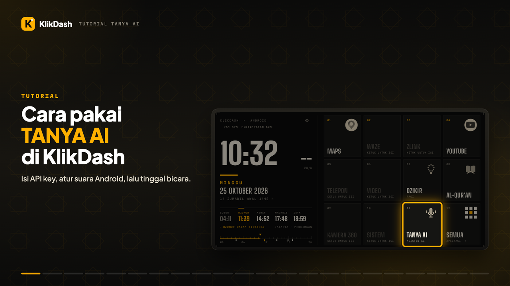

# Cara Pasang & Pakai KlikDash

Panduan untuk pemula. Tidak perlu komputer. Cukup headunit, flashdisk, dan internet (misalnya hotspot HP)
saat pertama kali memasang.

[English](INSTALL.md) | **Bahasa Indonesia**

> ⚠️ **Lakukan saat mobil diam.** Jangan mengoperasikan layar sambil menyetir.

▶️ Lebih suka video? Tonton **[tutorial pemasangan 5 menit di YouTube](https://youtu.be/sSRKIyC3Ato)**.

📺 Semua video KlikDash (pemasangan, TANYA AI, pencarian web TinyFish, update, USB debugging, Wireless debugging) ada di **[playlist YouTube](https://www.youtube.com/playlist?list=PLEAZ252hW8a4)**.

## Yang dibutuhkan

- Headunit Android **7 atau lebih baru**, idealnya dengan layar **1280×720** (dikembangkan dan diuji di NWD K2401)
- Flashdisk, atau cara lain untuk memindahkan file ke headunit
- Internet sekali untuk mengunduh teks Al-Qur'an (±6 MB), dan untuk murattal surah yang ingin diputar

## 1. Unduh aplikasinya

Di HP atau laptop, buka **[klikapps.pages.dev](https://klikapps.pages.dev)**, lalu ketuk **Download
KlikDash**. Bisa juga lewat halaman [Releases](https://github.com/ashafizullah/klikdash/releases/latest).
Hasilnya file bernama `klikdash-<versi>.apk`. Salin file itu ke flashdisk.

## 2. Pasang di headunit

1. Colok flashdisk ke port USB headunit.
2. Buka **File Manager** (kadang bernama *File Explorer*), lalu cari file `klikdash-<versi>.apk`.
3. Ketuk file itu, lalu pilih **Install**.
4. Kalau muncul peringatan *"aplikasi dari sumber tidak dikenal"*, ketuk **Setelan**, izinkan File Manager
   memasang aplikasi, lalu kembali dan ketuk **Install** lagi.

## 3. Jadikan tampilan utama

Buka **KlikDash**. Di kiri atas ada tombol kuning **JADIKAN TAMPILAN UTAMA**. Ketuk tombol itu.


- **Headunit NWD:** KlikDash langsung mengatur dirinya sebagai tampilan utama, lalu muncul pesan
  *"KlikDash sekarang tampilan utama"*. Tombol kuningnya pun hilang.
- **Headunit lain:** terbuka halaman **Aplikasi home default**. Pilih **KlikDash**, lalu tekan Kembali.


**Muncul pesan "Belum berhasil. Aktifkan USB debugging"?** Itu artinya opsi pengembang headunit masih mati.
▶️ Tonton **[video cara mengaktifkan USB debugging](https://youtu.be/eVMA64kG_H8)** (2 menit), atau ikuti langkah
ini. Nyalakan dulu:
1. Buka **Pengaturan › Tentang** (atau *Info perangkat*), lalu ketuk **Nomor build / Versi** 7 kali sampai
   muncul tulisan *"Anda sekarang pengembang"*. Beberapa headunit meminta kode pabrik di sini. Kodenya biasanya
   ada di buku manual atau bisa ditanyakan ke penjual (sering `8888`, `3368`, atau `1234`).
2. Buka **Pengaturan › Opsi pengembang**, lalu nyalakan **USB debugging**.
3. Kembali ke KlikDash dan ketuk lagi tombol kuningnya.

**Muncul pertanyaan "Allow USB debugging?"** setelah mengetuk tombol kuning? Itu headunit menanyakan izin
KlikDash memakai ADB-nya. Centang **Always allow**, lalu ketuk **OK**. Pertanyaan ini hanya muncul sekali.

**USB debugging sudah aktif, tapi ADB belum terbuka (port 5555)?** Umum di headunit Android 11 ke atas: ADB-nya
hanya mendengar kabel USB, belum terbuka untuk aplikasi di headunit itu sendiri. KlikDash bisa membukanya tanpa
komputer lewat **Wireless debugging** (▶️ **[video tutorialnya](https://youtu.be/qDb4Irg5wok)**, 3 menit): ketuk **Mulai** pada tawaran *Buka ADB tanpa komputer*, lalu:

1. Sambungkan headunit ke WiFi, misalnya hotspot HP.
2. Di **Opsi pengembang** (dibuka otomatis), nyalakan **Wireless debugging** dan izinkan jaringannya, lalu
   ketuk **Pair device with pairing code**.
3. Biarkan dialog kodenya terbuka. Tarik panel notifikasi, ketuk **KETIK KODE** pada notifikasi KlikDash, lalu
   masukkan kode 6 angkanya.
4. Pengaturan tertutup sendiri dan KlikDash tampil lagi. Wireless debugging dimatikan lagi otomatis.

Kalau headunit sudah pernah di-pair (Android mengingatnya hingga 7 hari), langkah 3 dilewati: cukup nyalakan
Wireless debugging. Bila dialog pairing tidak ditemukan, ketik port dan kodenya sekaligus (misalnya
`37215 482913`, port tertulis di bawah kode). Untuk **Hemat Daya**, ketuk pesan *ADB belum terbuka* di tab itu:
port 5555 ikut dibuka sampai headunit dinyalakan ulang.

Headunit tanpa menu Wireless debugging (atau Android 10 ke bawah) perlu komputer yang terpasang
[Android platform-tools](https://developer.android.com/tools/releases/platform-tools):

1. Sambungkan headunit dan komputer ke WiFi yang sama (misalnya hotspot HP).
2. Di headunit, buka **Pengaturan › Opsi pengembang › Wireless debugging** (*Debugging nirkabel*), nyalakan,
   lalu ketuk **Pair device with pairing code**. Catat alamat (`IP:port`) dan kode 6 angkanya.
3. Di komputer, jalankan:
   ```
   adb pair IP:PORT_PAIRING KODE
   adb connect IP:PORT
   adb tcpip 5555
   ```
   `IP:PORT` adalah alamat yang tertulis di halaman utama Wireless debugging (bukan alamat pairing).
   Kalau port USB headunit bisa disambungkan ke komputer, cukup sambungkan kabelnya lalu jalankan `adb tcpip 5555`.
4. Kembali ke KlikDash, ketuk lagi tombol kuningnya, lalu izinkan seperti di atas.

Pilihan tampilan utama tersimpan permanen, jadi langkah ini cukup sekali. Port 5555 tertutup lagi setelah
headunit dinyalakan ulang, sehingga **Hemat Daya** dan penyetelan otomatis (ksmd, Zlink) tidak jalan sampai
dibuka lagi. Agar tetap terbuka, jalankan juga `adb shell setprop persist.adb.tcp.port 5555` (tidak semua
firmware mengizinkannya). ADB yang terbuka memberi akses penuh ke headunit: sambungkan hanya ke jaringan
pribadi, jangan ke WiFi publik.

## 4. Izinkan lokasi

Saat diminta, ketuk **Izinkan**. Lokasi dipakai untuk menghitung jadwal sholat sesuai kota Anda. Sebelum GPS
mendapat sinyal, jadwalnya memakai kota perkiraan (misalnya *JAKARTA · PERKIRAAN*). Parkir di tempat
terbuka supaya GPS cepat mendapat sinyal.

## 5. Al-Qur'an

1. Sambungkan headunit ke internet, misalnya lewat hotspot HP.
2. Ketuk pintasan **AL-QUR'AN**, lalu ketuk **UNDUH TEKS**. Cukup sekali; setelah itu mushaf bisa dibaca offline.

   

3. Pilih surah, lalu ketuk ayat atau tombol ▶. Murattal Mishary Alafasy diunduh sambil diputar.
4. Ingin bisa diputar tanpa internet di perjalanan? Ketuk **UNDUH** di surah itu sebelum berangkat. Surah
   yang sudah lengkap ditandai **OFFLINE**.

   

Murattal tetap berbunyi saat Anda membuka Maps atau aplikasi lain, dan bisa dijeda atau dilanjutkan dari
notifikasi atau tombol media (termasuk tombol setir, bila headunit meneruskannya ke aplikasi).

## Dzikir pagi & petang

Ketuk pintasan **DZIKIR** di samping AL-QUR'AN. Sebelum Ashar yang terbuka dzikir pagi, sejak Ashar dzikir petang;
bisa diganti dengan tombol **PAGI** / **PETANG**. Baca teksnya, lalu ketuk tombol kuning besar setiap selesai
satu kali bacaan. Begitu jumlahnya terpenuhi (misalnya 3×), layar pindah sendiri ke bacaan berikutnya. Progres
hari itu tersimpan, jadi aman ditinggal lalu dilanjutkan.

## 6. Wajib dicek sebelum berkendara

Dalam keadaan mobil diam, pastikan semua ini masih berfungsi:
- **Kamera mundur:** masukkan gigi R, gambar kamera harus langsung muncul
- **Kamera 360** (jika ada)
- **Peringatan pintu terbuka** dan info mobil
- **Tombol setir:** volume, lagu berikutnya, dan telepon
- **Radio, Bluetooth, dan telepon**

Kalau ada yang tidak jalan, **kembalikan ke launcher bawaan** (lihat di bawah), lalu laporkan lewat
[issue](https://github.com/ashafizullah/klikdash/issues). **Jangan berkendara dengan kamera mundur yang
tidak berfungsi.**

## Pemakaian sehari-hari

- **Buka aplikasi:** ketuk pintasannya.
- **Ganti aplikasi di pintasan:** tekan lama pintasan, lepas di tempat, lalu pilih aplikasinya.
- **Tukar posisi pintasan:** tekan lama pintasan, geser ke pintasan lain, lalu lepas.
- **Semua aplikasi:** ketuk pintasan **SEMUA**. Ketuk **CARI APLIKASI** lalu ketik sebagian namanya untuk
  menyaring; bila tinggal satu, tombol cari di keyboard langsung membukanya. Tekan lama sebuah aplikasi di sana untuk
  membuka infonya (misalnya untuk uninstall).
- **Pintasan lebih besar:** ketuk **⚙**, lalu di **JUMLAH PINTASAN** pilih 9, 6, atau 4 (bawaan 12, termasuk SEMUA).
  Makin sedikit, makin besar jam, kecepatan, tanggal, dan jadwal sholat di kiri, juga pintasan, ikon, dan tulisannya. Pintasan yang tidak tampil tetap tersimpan dan muncul
  lagi bila jumlahnya ditambah.
- **Suhu CPU** di kiri atas berwarna amber mulai 70 °C dan merah ("PANAS") mulai 85 °C.

## Hemat Daya

Headunit terasa panas atau lambat? Sebagian aplikasi, misalnya Netflix atau Spotify, bisa berjalan diam-diam di
latar walaupun tidak dibuka. Untuk membatasinya:

1. Ketuk tombol **⚙** di atas layar home (di samping suhu CPU), lalu tab **HEMAT DAYA**.
2. Ketuk **BATASI** di aplikasi yang tidak perlu jalan di latar. Tulisannya berubah menjadi **DIBATASI**.
   Aplikasi yang *SEDANG BERJALAN DI LATAR* tampil paling atas.


Aplikasinya **tidak dihapus** dan tetap bisa dibuka seperti biasa; ia hanya tidak bisa jalan sendiri di
belakang. Ketuk lagi untuk mengizinkan, atau **KEMBALIKAN SEMUA** untuk mengembalikan semuanya. Aplikasi
sistem, Maps, Waze, dan Zlink sengaja tidak ditampilkan supaya navigasi dan CarPlay tetap jalan. Fitur ini butuh
USB debugging aktif, sama seperti tombol tampilan utama.

## Asisten suara (TANYA AI)

▶️ Lebih suka video? Tonton **[tutorial TANYA AI 6 menit di YouTube](https://youtu.be/v9Bm6FzUKm8)**: mengisi API key Claude atau
layanan OpenAI-compatible, memakai suara Android yang gratis, sampai memberi perintah suara pertama.

[](https://youtu.be/v9Bm6FzUKm8)

Opsional. TANYA AI mengerti perintah singkat, misalnya *"putar surat Yasin"*, *"navigasi ke masjid terdekat pakai
Waze"*, *"buka Zlink"*, atau *"stop murottalnya"*, dan menjawab dengan suara.

1. Siapkan API key dari [console.anthropic.com](https://console.anthropic.com) (Claude) atau penyedia
   OpenAI-compatible lain. ElevenLabs ([elevenlabs.io](https://elevenlabs.io)) opsional; key-nya butuh izin
   *Text to Speech*, *Speech to Text*, dan *Voices*.
2. Buka **⚙ › ASISTEN AI**, ketuk **+ CLAUDE** (atau **+ OPENAI-COMPATIBLE**), tempel key-nya, ketuk
   **PILIH MODEL** untuk memilih model (Claude Haiku 5.5 paling cepat), lalu **SIMPAN** dan **UJI**.
   Mengetik key panjang di headunit itu repot: ketuk kolomnya, lalu dari komputer jalankan
   `adb shell input text 'KEY_ANDA'`.
3. Suara: di **SUARA JAWABAN** dan **PENGENALAN SUARA**, **ANDROID** gratis; keterangannya menyebut aplikasi Android
   yang dipakai. Bila aplikasinya belum terpasang, ketuk **PASANG** untuk membukanya di Play Store (Speech
   Recognition & Synthesis untuk suara, aplikasi Google untuk pengenal suara); di Speech Recognition & Synthesis,
   unduh suara bahasa Indonesia agar jawaban dibacakan offline. **DENGAR** untuk mencoba. Untuk ElevenLabs, ketuk
   **API KEY** di **SUARA ELEVENLABS** lalu tempel key-nya; tombol **ELEVENLABS** baru bisa dipilih setelah itu,
   suara Indonesia langsung terpasang, dan **SUARA** untuk memilih suara lain.
4. Pencarian web: TANYA AI mencari info terkini (berita, harga, cuaca, jadwal) bila perlu. Profil Claude resmi
   langsung bisa mencari lewat pencarian Anthropic, ditagih ke akun Claude ($10 per 1.000 pencarian). Supaya semua
   profil mencari lewat TinyFish (gratis), buat API key di [agent.tinyfish.ai](https://agent.tinyfish.ai), lalu di
   **PENCARIAN WEB** ketuk **KEY TINYFISH**, tempel, dan pastikan **AKTIF** terpilih.
5. Taruh TANYA AI di home: tekan lama salah satu pintasan, lepas di tempat, lalu pilih **Tanya AI**.


Key disimpan terenkripsi di headunit dan hanya dikirim ke penyedia yang Anda atur. Pemakaian ditagihkan ke akun
Anda sendiri.

## Pembaruan

Buka **⚙ › LAUNCHER** lalu ketuk **CEK UPDATE**. Bila ada versi baru, ketuk **Unduh & pasang**: KlikDash
memastikan unduhannya ditandatangani kunci yang sama, memasangnya, lalu terbuka lagi. Pengaturan dan audio yang
sudah diunduh tetap ada.


## Kembali ke launcher bawaan

Buka **⚙ › LAUNCHER**, ketuk **LAUNCHER BAWAAN**, lalu konfirmasi. KlikDash tetap terpasang dan bisa dijadikan
tampilan utama lagi kapan saja.

Mau menghapus KlikDash sepenuhnya? Buka **Pengaturan › Aplikasi › KlikDash › Uninstall**. Audio murattal
yang sudah diunduh ikut terhapus.

## Tanya jawab

**Setelah restart, tampilan lama yang muncul.**
Buka KlikDash dari daftar aplikasi, lalu ketuk lagi tombol kuning **JADIKAN TAMPILAN UTAMA**. Pada headunit
NWD, pengaturan ini tersimpan permanen dan biasanya cukup dilakukan sekali.

**Muncul "AUDIO BELUM ADA · SAMBUNGKAN INTERNET".**
Murattal untuk surah itu belum diunduh. Sambungkan internet, lalu putar lagi atau ketuk **UNDUH**.

**WiFi mati sendiri saat CarPlay atau Android Auto nirkabel tersambung.**
Itu normal. CarPlay nirkabel memakai hotspot headunit, dan headunit tidak bisa menjalankan hotspot dan WiFi
biasa bersamaan. Unduh surah yang ingin diputar sebelum menyambungkan CarPlay.

**Ada pintasan yang kosong atau bertulisan "KETUK UNTUK ISI".**
Aplikasi bawaan untuk pintasan itu tidak ada di headunit Anda. Ketuk pintasan itu, lalu pilih aplikasi lain.

**Suhu CPU tidak tampil.**
Sensor suhu di headunit itu tidak bisa dibaca oleh aplikasi. Fitur lain tetap jalan.

**Tanggal Hijriah beda satu hari dari pengumuman resmi.**
Ketuk tanggal Hijriah di home, lalu pilih koreksi −2 sampai +2 hari.

**Kecepatan tampil "--".**
GPS belum mendapat sinyal, misalnya di basement atau garasi. Angkanya muncul lagi begitu GPS mendapat sinyal.
Kecepatan dari GPS bisa sedikit berbeda dari speedometer mobil; speedometer biasanya menunjukkan sedikit lebih
tinggi.

**Jadwal sholat berbeda sekitar satu menit dari masjid.**
Jadwal dihitung dengan metode Kemenag dan bisa selisih sekitar satu menit. Ikuti masjid atau otoritas
setempat.
